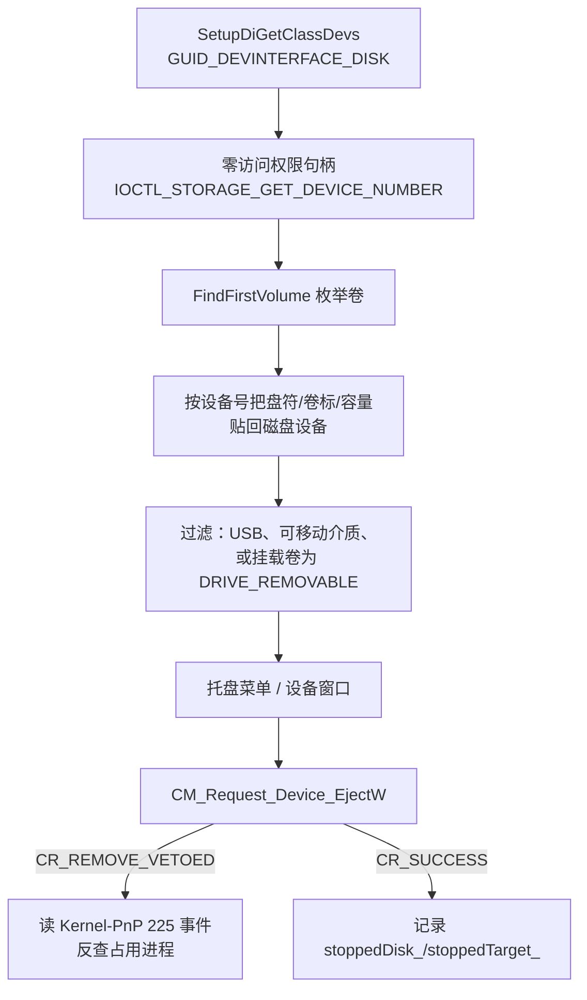

# 架构 / Architecture

面向维护者和想改这个工具的人：说明当前的组件边界、关键数据流和已经付出的取舍。设计决策的理由见 [docs/adr/](adr/)，命令行的完整契约见 [docs/command-line.md](command-line.md)。

**English:** this page describes the current component boundaries, the main data flows and the trade-offs already paid. Rationale lives in [docs/adr/](adr/).

## 系统边界 / What this is

一个 Windows GUI 子系统可执行文件（没有控制台窗口），同时充当命令行工具。它拥有托盘图标，枚举 USB 存储设备，并请求 PnP 移除。

它**不**自己挂载或卸载卷（退卡时的加锁除外），**不**实现强制弹出，**不**自动更新。除了 Windows SDK 的导入库之外没有第三方运行时依赖。

**English:** one GUI-subsystem executable that doubles as a command-line tool. It owns a tray icon, enumerates USB storage and requests PnP removal. It does not mount or unmount volumes itself, does not force-eject, and does not self-update. There are no third-party runtime dependencies.

## 组件 / Components

| 组件 | 位置 | 职责 |
|---|---|---|
| 入口 | `src/main.cpp` | 参数解析、CLI 分发、提权 helper 模式、消息循环之前的全部准备 |
| 应用外壳 | `src/app/` | 启动顺序、单实例与唤醒、设置读写、日志、开机自启 |
| 设备层 | `src/core/` | 枚举、卷关联、弹出、退卡、占用诊断、SMART、端口重连——全部与 UI 无关 |
| 界面层 | `src/ui/` | 托盘、隐藏窗口与消息循环、对话框主题、通知卡片 |
| 字符串 | `src/i18n/` | 中英两列表与 `%1/%2/%3` 单遍替换 |
| 工具库 | `src/util/` | UTF-8/UTF-16 转换与格式化、JSON 解析与原子保存、Win32 RAII |

`src/core/` 不 include 任何 `src/ui/` 或 `src/app/` 的头文件（`Logger` 除外，见下），因此可以在控制台测试里整层链接。`src/ui/` 只通过 `src/core/` 的公开接口拿数据。

## 关键数据流 / Main flows

### 设备枚举 → 弹出

文字说明：先用 SetupAPI 枚举磁盘设备接口，以 **0 访问权限** 打开每个接口取设备号、总线类型、可移动标志和厂商/产品字符串；再用 `FindFirstVolume` 枚举卷，同样取 `STORAGE_DEVICE_NUMBER`，用**设备号**把卷的盘符、卷标、容量贴回磁盘；最后只保留 USB、可移动介质、或挂载卷报告 `DRIVE_REMOVABLE` 的磁盘，并排除承载当前 Windows 卷的磁盘号。弹出走 `CM_Request_Device_EjectW`，节点先经 `RemovalTarget` 提升到可安全移除的 USBSTOR/UASPStor 传输节点；被拒绝时读取 `[请求时刻, CM 返回]` 时间窗内的 Kernel-PnP 225 事件反查占用进程。

**English:** enumerate disk interfaces with SetupAPI, open each with zero access to read its device number and bus type, enumerate volumes the same way, and re-associate them by device number. Ejection goes through `CM_Request_Device_EjectW` on the transport node `RemovalTarget` resolves; a veto is explained from Kernel-PnP 225 events inside the request window.

### 退卡 / Card eject

`MediaEject` 先读分区布局，把分区分成两类：**必须有卷的**（`expected`）和**默认不挂卷的**（`optional`：Microsoft 保留分区、EFI 系统分区、LDM 元数据分区、MBR 扩展容器）。然后对每个卷接口取 `IOCTL_VOLUME_GET_VOLUME_DISK_EXTENTS`，extent 必须落在某一类分区里——落在 `optional` 里也算合法，因为用户可能给这类分区加了盘符。最后锁住全部卷再发 `IOCTL_STORAGE_EJECT_MEDIA`。

跨多个 extent 或跨磁盘的卷单独报 `volume_multi_extent`，不冒充成「设备被更换」。

### 占用文件诊断 / Open-file diagnosis

父进程不能直接打开别人的进程做 PSS 快照后还保持响应，所以每个被报告的 PID 起一个 `--file-worker` 子进程，通过一段 GUID 命名的共享内存回传 JSON。父进程用严格 schema 校验子进程的输出——**并且要求每条路径落在本设备某个卷的挂载点之下**，因为共享段的名字虽然 GUID 化，同会话的进程仍可能写它。

### 提权重启 / Elevated restart

端口重连需要管理员权限。父进程用 `ShellExecuteEx` + `runas` 起同一个可执行文件的 helper 模式（`--restart-held-usb` / `--restart-held-node`），把实例 ID 通过命令行传过去。helper **故意不初始化日志、不读设置**：它在提权后运行，只做一件事，并在重启前重新核对磁盘类别 GUID、父子关系、USBSTOR/UASPStor 服务名和 `CM_PROB_HELD_FOR_EJECT` 节点状态。参数跨了进程边界，所以身份必须重新验证，不能信父进程传过来的值。

## 持久化 / Persistence

| 数据 | 位置 | 机制 |
|---|---|---|
| 设置 | `%APPDATA%\USB-Switch\settings.json` | 临时文件 + `MoveFileEx` 原子替换；未知键原样回写；损坏时另存 `.corrupt` 并回退默认值 |
| 日志 | `%LOCALAPPDATA%\USB-Switch\logs\usb-switch.log` | 1 MiB 轮转（保留一份 `.old`）；以仅共享读独占打开；抢不到主文件名时退到 `usb-switch.<pid>.log`，每个家族滚动保留 8 个 |

## 依赖 / Dependencies

只用 Windows SDK 导入库：`setupapi`（枚举）、`cfgmgr32`（PnP 弹出）、`wevtapi`（事件日志）、`comctl32`、`shell32`（托盘）、`ole32`、`advapi32`（注册表）、`user32`、`gdi32`、`dwmapi`、`uxtheme`。没有第三方库，没有包管理器依赖。

## 信任边界 / Trust boundaries

- **`--file-worker` 子进程**：同用户、同会话。共享段名是 GUID，但同会话进程理论上可写，因此父进程校验 schema 并要求路径落在目标卷的挂载点之下。
- **提权 helper**：以管理员身份运行，输入只有命令行上的两个实例 ID。它重新验证身份，不读设置、不写日志、不执行外部命令。
- **UAC 提示**：只在用户明确选择「打开系统授权提示」时出现，程序不自行提权。
- **日志内容**：可能包含设备名称和实例 ID。分享前需人工检查。

## 已经付出的取舍 / Trade-offs

- **零访问权限句柄做枚举**：不弹权限框，但部分 IOCTL 在部分驱动上不支持，失败就被跳过（设备不出现在列表里）。
- **按设备号关联卷，而不是按挂载点**：稳，但没有任何挂载点的卷对程序不可见——安全弹出不受影响，退卡用不了它。
- **每个 PID 起一个子进程做占用诊断**：父进程不被阻塞，代价是进程启动开销和 3.5 秒的共享预算。
- **250 ms 防抖用单个定时器**：把一次物理插拔的多条 `WM_DEVICECHANGE` 折叠成一次扫描，因此定时器不能被事件流不断重置。
- **对话框自绘**：换来主题、高对比度与圆角，代价是必须自己处理 `WM_DPICHANGED` 重排。
- **不实现强制弹出**：安全优先于能力，理由见 [docs/adr/0001-no-force-eject.md](adr/0001-no-force-eject.md)。

## 测试如何切入 / How tests reach in

`src/core/` 的 Win32 调用通过函数指针缝点注入（见 `src/core/MediaEject.h` 的 `MediaIo`、`src/core/SmartInfo.h` 的 `SmartIo`），因此分区匹配和 ATA PASS-THROUGH 的 CDB 字节可以在没有磁盘的情况下断言。`tests/media-partitions.cpp` 与 `tests/smart-passthrough.cpp` 用的就是这个缝点；`src/ui/` 没有对应缝点，只做编译检查和 GUI 冒烟。

**English:** `src/core/` injects its Win32 calls through function-pointer seams, so partition matching and the pass-through CDB bytes are assertable without real hardware. `src/ui/` has no such seam and is covered by compilation plus a GUI smoke test.
